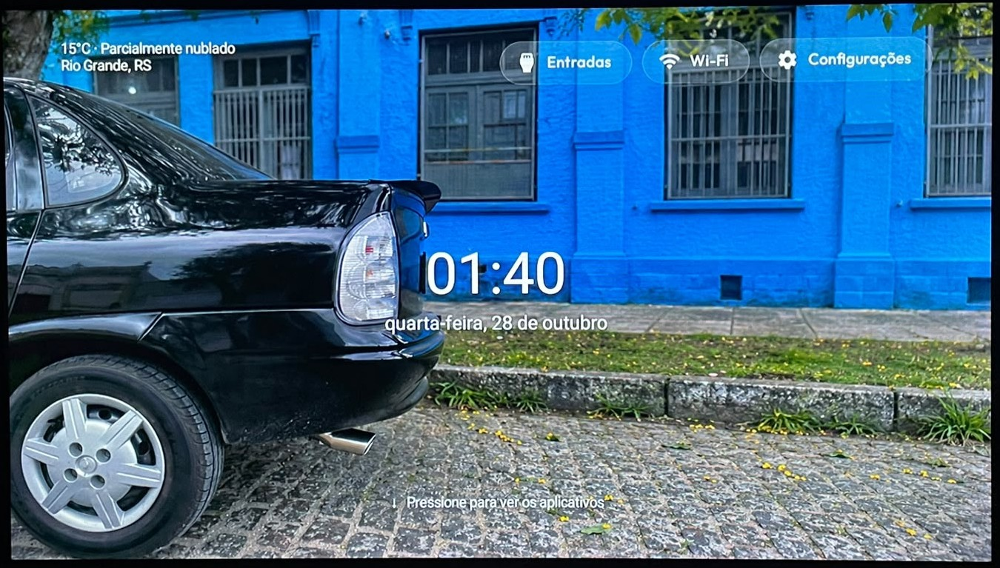
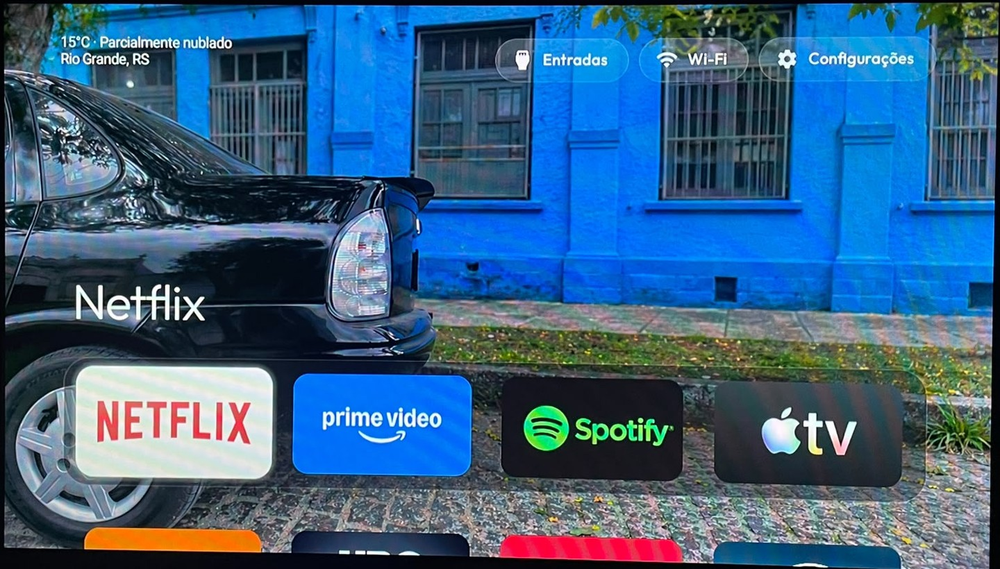
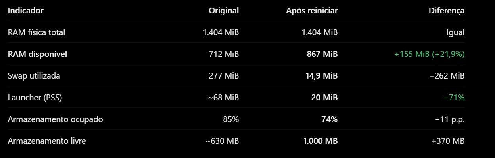

# CleanYourTV — TCL Custom Home

**SEMP TCL 32S6500S · Android TV 9 · Interface personalizada + otimização real do sistema**

**Resultado na TV testada:** interface mais fluida e, conforme o uso relatado pelo responsável, **os travamentos que aconteciam antes da otimização deixaram de ocorrer**. Também medimos mais RAM disponível, redução do consumo do launcher e liberação de armazenamento. Veja abaixo os números, os pacotes envolvidos e o procedimento para reproduzir com cautela.

> Personalização do launcher open-source [CleanYourTV](https://github.com/Gathin23/cleanyourtv), baseada na versão **v3.1.0** e testada em uma **SEMP TCL 32S6500S (Android TV 9)**. Este repositório é um **fork com modificações**, não um launcher desenvolvido do zero.

## Visão geral

A otimização reuniu **duas frentes complementares**: substituição da Home por uma versão personalizada do CleanYourTV **e** limpeza manual de aplicativos/serviços dispensáveis via ADB, com ajustes das animações do Android. O objetivo foi reduzir a carga sobre o hardware limitado desta TV sem perder streaming, cast, HDMI, Wi-Fi e configurações.

Na tela inicial, ficam visíveis apenas o papel de parede configurado pelo usuário, o relógio, a data, o clima e os atalhos superiores. A grade de aplicativos aparece ao pressionar **↓** no controle remoto e é ocultada com **Voltar** ou **↑** na primeira linha. Ao abrir a Home, nenhum botão superior fica destacado.

<!-- INICIO GALERIA TCL -->
## Demonstração na TV real

### Tela inicial limpa



Relógio, data e clima em destaque. Os aplicativos ficam ocultos até pressionar **↓** no controle remoto.

### Aplicativos ao pressionar ↓



A grade pode ser exibida e ocultada sem fechar os serviços essenciais da televisão.

### Comparativo de memória e armazenamento



> **Importante sobre o teste:** as **duas** medições — original e otimizada — foram realizadas **logo após ligar/reiniciar a TV**, em cada uma das situações. A imagem usa a legenda "Após reiniciar" para o resultado otimizado, mas **o original também foi medido depois de ligar a TV**. Com isso, a comparação é mais coerente do que confrontar uma sessão longa com uma recém-reiniciada. Ainda não é um benchmark cronometrado e repetido.
<!-- FIM GALERIA TCL -->

## O que foi feito na TV

### 1. Substituição e personalização do launcher

- Instalamos uma versão compilada e personalizada do **CleanYourTV v3.1.0**, substituindo a Home antiga (`com.google.android.tvlauncher`) pela `com.gathin.tvhome`.
- **Tela inicial minimalista:** wallpaper pessoal, relógio e data centralizados, sem elementos extras cobrindo a imagem.
- **Aplicativos ocultos por padrão:** seta **↓** abre a grade; **Voltar** ou **↑** na primeira linha a escondem. A grade é ocultada sem ser recriada toda vez.
- **Sem botão destacado inicialmente:** foco colocado em elemento transparente ao voltar à Home.
- **Clima de Rio Grande (RS)** no topo, obtido via [Open-Meteo](https://open-meteo.com/), consultado no máximo uma vez por hora e com nova tentativa em caso de falha. Consulta feita em uma thread curta, não em serviço persistente em segundo plano.
- **Entradas, Wi-Fi e Configurações** continuam disponíveis na barra superior; streaming e Chromecast foram preservados.
- Escondemos elementos decorativos da interface original, mantendo o launcher leve e sem novas animações adicionadas.

| Arquivo alterado | Papel |
| --- | --- |
| `launcher/app/src/main/java/com/gathin/tvhome/MainActivity.java` | Integração da Home personalizada, controle remoto e navegação |
| `launcher/app/src/main/java/com/gathin/tvhome/TclHomeCustom.java` | Layout centralizado, relógio/data, clima, foco e grade |
| `launcher/app/src/main/AndroidManifest.xml` | Permissão de internet para o clima |

> O wallpaper é configurado separadamente na TV: **não** faz parte do código nem é distribuído como arquivo de tema neste repositório.

### 2. Limpeza do Android TV via ADB (debloat)

Além do launcher, **desativamos pacotes de interface antiga, recomendações, assistente de voz e serviços opcionais da TCL/Google**. Isso foi feito **manualmente na TV**, não por este aplicativo. A lista consolidada do trabalho inclui:

| Pacote | O que representa | Atenção |
| --- | --- | --- |
| `com.google.android.tvlauncher` | Launcher original Google Android TV | ⚠️ Impacto funcional possível |
| `com.tcl.appmarket2` | Loja de aplicativos TCL | Dispensável conforme uso |
| `com.google.android.tvrecommendations` | Recomendações Android TV | Dispensável conforme uso |
| `com.tcl.bi` | Serviço TCL BI | Dispensável conforme uso |
| `com.google.android.feedback` | Feedback do Google | Dispensável conforme uso |
| `com.tcl.esticker` | TCL eSticker | Dispensável conforme uso |
| `com.google.android.music` | Google Play Música | Dispensável conforme uso |
| `com.google.android.videos` | Google Play Filmes | Dispensável conforme uso |
| `com.google.android.katniss` | Assistente Google para TV | ⚠️ Impacto funcional possível |
| `com.google.android.speech.pumpkin` | Reconhecimento de voz | ⚠️ Impacto funcional possível |
| `com.tcl.partnercustomizer` | Personalização TCL | Dispensável conforme uso |
| `com.tcl.tvweishi` | TV Weishi | Dispensável conforme uso |
| `com.google.android.tv.bugreportsender` | Relatórios de erro Android TV | Dispensável conforme uso |
| `com.tcl.partnercustomizer.resource` | Recursos da personalização TCL | Dispensável conforme uso |
| `com.google.android.leanbacklauncher.partnerwidget` | Widget do Leanback | Dispensável conforme uso |
| `com.google.android.leanbacklauncher.partnercustomizer` | Personalização do Leanback | Dispensável conforme uso |
| `com.tcl.waterfall.overseas` | Recurso TCL Waterfall | Dispensável conforme uso |
| `com.google.android.play.games` | Google Play Games | Dispensável conforme uso |
| `com.android.printspooler` | Spooler de impressão | Dispensável conforme uso |
| `com.google.android.tts` | Síntese de fala do Google | ⚠️ Impacto funcional possível |
| `com.google.android.marvin.talkback` | TalkBack | ⚠️ Impacto funcional possível |

Também retiramos **Claro TV+** (`com.claro.now.smarttvclient`) e **Pluto TV** (`tv.pluto.android`) dos apps utilizados. O registro disponível não contém o comando final desses dois; por isso não afirmamos que foram excluídos fisicamente do firmware ou que o método foi idêntico ao dos pacotes acima.

**Precisão do registro:** quatro desativações têm saída `new state: disabled-user` preservada no histórico: `com.google.android.katniss`, `com.google.android.speech.pumpkin`, `com.tcl.tvweishi` e `com.tcl.partnercustomizer`. Os demais nomes vêm do resumo consolidado das alterações realizadas. Confirme o estado atual com `adb shell pm list packages -d` antes de repetir qualquer comando. **Não rode toda a lista em lote:** alguns serviços são necessários para voz, acessibilidade ou a Home original.

**Tutorial reproduzível e reversível:** [passo a passo completo de ADB, explicação dos pacotes, comandos e recuperação](docs/OTIMIZACAO-ADB-TCL.md).

### 3. Ajustes da interface e animações

Verificamos as escalas globais de animação (`window_animation_scale`, `transition_animation_scale` e `animator_duration_scale`). Há registro de leitura das três em `0.0` e de um ajuste posterior para `0.5`; não temos uma conferência final do valor que permaneceu na TV. **Ambas as opções são explicadas no tutorial**. Esse ajuste pode tornar a navegação visual mais imediata, mas não altera a capacidade física do hardware.

## Resultados da otimização

**A TV ficou perceptivelmente mais fluida no uso relatado, e os travamentos anteriormente observados deixaram de se manifestar após as mudanças.** Além da experiência prática, obtivemos resultados objetivos:

| Indicador | Original, logo após ligar | Otimizada, logo após ligar | Diferença observada |
| --- | ---: | ---: | ---: |
| RAM física total | 1.404 MiB | 1.404 MiB | Sem alteração |
| **RAM disponível (`MemAvailable`)** | ~712 MiB | ~867 MiB | **+155 MiB (+21,8%)** |
| **PSS do launcher** | ~68 MiB (Google) | ~20 MiB (CleanYourTV) | **−48 MiB (−70,6%)** |
| **Swap em uso** | ~277 MiB | ~14,9 MiB | **−262 MiB (−94,6%)** |
| Ocupação de `/data` | 85% | 74% | **−11 pontos percentuais** |
| **Armazenamento livre em `/data`** | ~630 MB | ~1.000 MB | **+370 MB** |

### Como a comparação foi feita

**Os dois conjuntos foram coletados logo após ligar/reiniciar a mesma SEMP TCL 32S6500S**, antes e depois das alterações. Portanto, não se tratou de comparar uma TV antiga já aberta havia horas contra outra recém-iniciada. O gráfico acima resume esses resultados.

A melhora de memória e armazenamento é **medida**, não apenas impressão. A diminuição dos travamentos é um **relato de uso real** no aparelho testado. Como houve mudanças simultâneas (launcher, pacotes e animações) e não fizemos várias repetições padronizadas com cronômetro e mesmos aplicativos carregados, **não atribuímos o ganho exclusivamente ao launcher**, nem declaramos uma porcentagem comprovada de aumento de velocidade. O consumo de RAM e swap continua variando com o uso.

**Serviços preservados durante o projeto:** Netflix, YouTube, Prime Video, Disney+, Max, Globoplay, Apple TV, Crunchyroll, Spotify, Chromecast/cast, HDMI, TV aberta, Wi-Fi, Bluetooth, configurações e controle remoto. Nem todos foram necessariamente testados em uma única sessão; o objetivo foi manter seu funcionamento.

> **Importante:** esta otimização **não requer root, overclock ou substituição do firmware**. O fork inclui a Home personalizada e a documentação, **não executa** automaticamente os comandos ADB de desativação dos pacotes.

## Tecnologias

Java · Android TV · Android SDK · Gradle · ADB · PowerShell · JSON · API Open-Meteo

## Compilação

Pré-requisitos: **JDK 17**, **Android SDK Platform 34** e **Build Tools 34**. A partir da raiz do repositório, no Windows:

```powershell
cd launcher
.\gradlew.bat --no-daemon assembleRelease
```

O APK resultante fica em `launcher/app/build/outputs/apk/release/app-release.apk`.

Para instalar **somente na sua TV**, com ADB já autorizado:

```powershell
adb connect <IP_DA_SUA_TV>:5555
adb install -r .\app\build\outputs\apk\release\app-release.apk
```

Se houver erro de assinatura, **não desinstale automaticamente a versão existente**: faça backup, confira a assinatura e preserve os dados do aplicativo.

**Atenção:** a implementação do clima utiliza coordenadas aproximadas e fixas de Rio Grande, RS. Para outra cidade, altere a URL da API em `TclHomeCustom.java`. Os dados da previsão dependem de internet; o restante da Home continua funcionando se a consulta falhar.

## Autoria e créditos

- **Projeto original:** [Gathin23 / CleanYourTV](https://github.com/Gathin23/cleanyourtv), licença [MIT](LICENSE).
- **Esta adaptação:** personalização, compilação e testes em TV real, com assistência de inteligência artificial.
- **Fonte tipográfica original:** respeitar o arquivo `launcher/FONT-LICENSE-OFL.txt` incluído pelo projeto original.

Os arquivos de código do upstream permanecem sujeitos aos avisos de copyright e às licenças existentes. Este fork não é afiliado à TCL, à Google ou ao projeto oficial.

## Próximas melhorias possíveis

- Transformar cidade e frequência do clima em opções configuráveis.
- Adicionar testes automatizados de navegação por controle remoto.
- Fazer comparações de desempenho com condições de medição padronizadas.
